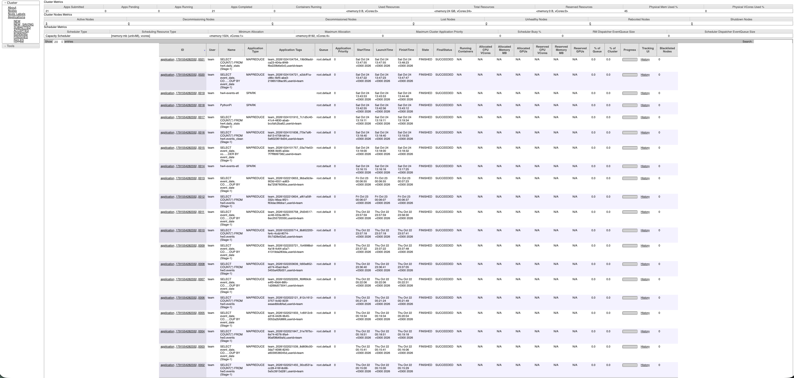

# Домашнее задание №4 — Apache Spark на YARN

Запуск Apache Spark под управлением YARN поверх кластера из [ДЗ №1 (HDFS)](https://github.com/g1rone/hadoop-hw1), [ДЗ №2 (YARN)](https://github.com/g1rone/yarn-hw2) и [ДЗ №3 (Hive)](https://github.com/iosmoke1/hive-hw3). Spark читает CSV из HDFS, трансформирует данные и сохраняет их как партиционированные таблицы Hive, которые затем читает стандартный клиент Beeline.

## 1. Архитектура

| ВМ           | IP           | Сервисы                                                                                                                      |
|--------------|--------------|------------------------------------------------------------------------------------------------------------------------------|
| `team-22-en` | `10.22.0.10` | Edge, SecondaryNameNode, DataNode, NodeManager, JobHistoryServer, nginx, HiveServer2, Hive Metastore, PostgreSQL, **Spark (драйвер)** |
| `team-22-nn` | `10.22.0.11` | NameNode, ResourceManager                                                                                                    |
| `team-22-00` | `10.22.0.12` | DataNode, NodeManager (контейнеры Spark)                                                                                     |
| `team-22-01` | `10.22.0.13` | DataNode, NodeManager (контейнеры Spark)                                                                                     |

Использованы Hadoop **3.4.1**, Java **11**, Hive **4.0.0-alpha-2**, Spark **3.5.3** (сборка `bin-hadoop3`) и PySpark. Spark установлен только на edge-машине; Hadoop, YARN и Hive из предыдущих заданий не переустанавливались и не перенастраивались.

Приложение запускается в режиме `--master yarn --deploy-mode client`: ApplicationMaster и executor-ы работают в контейнерах YARN на трёх NodeManager, а драйвер — на edge. Режим `client` выбран потому, что Hive Metastore из ДЗ №3 слушает только `127.0.0.1:9083`: в режиме `cluster` драйвер оказался бы на другой машине и не достучался бы до него. Jar-файлы Spark лежат в HDFS (`spark.yarn.archive`), поэтому на DataNode/NodeManager Spark ставить не нужно, достаточно `python3`.

Spark ходит в Metastore как обычный клиент (`config/hive-site.xml`), метаданные хранятся в PostgreSQL из ДЗ №3, данные таблиц — Parquet-файлы в HDFS.

## 2. Структура репозитория

```
spark-hw4/
├── deploy.sh                   # Установка Spark и настройка под YARN
├── create_tables.sql           # Запасной путь: регистрация таблиц в Hive
├── jobs/
│   └── events_etl.py           # PySpark: чтение, трансформации, сохранение
├── scripts/
│   ├── load.sh                 # Данные в HDFS и запуск Spark на YARN
│   ├── verify.sh               # Проверки через Beeline и YARN
│   └── rollback.sh             # Откат только Spark
├── config/                     # spark-defaults.conf, spark-env.sh, hive-site.xml
├── data/                       # Входные CSV по дням (с «грязными» строками)
├── evidence/                   # Логи запусков
└── screenshots/                # Результат в веб-интерфейсе YARN
```

## 3. Развёртывание

Все команды запускаются на `team-22-en` от пользователя `team` (требуется `sudo`):

```
cd ~/spark-hw4
chmod +x deploy.sh scripts/*.sh
./deploy.sh
```

`deploy.sh` выполняет следующие шаги:

1. Проверяет Java, HDFS, YARN, три работающих DataNode и NodeManager и активные сервисы `hive-metastore` и `hive-server2`.
2. Проверяет `python3` на всех ВМ (нужен PySpark-executor-ам).
3. Скачивает Spark 3.5.3 и проверяет SHA-512 архива, распаковывает в `/opt`.
4. Копирует конфигурацию: `master=yarn`, адрес драйвера, память executor-ов, путь к Metastore.
5. Создаёт каталоги `/user/team/spark-hw4/` в HDFS и загружает туда архив jar-ов Spark.
6. Запускает контрольную задачу SparkPi на YARN.

Повторный запуск установки предусмотрен: существующая установка, конфиги и каталоги не ломаются.

## 4. Загрузка данных

В папке `data/` лежат CSV-файлы с заголовком `event_id,user_id,event_type,country,amount,event_ts`, по одному на день (`events_YYYY-MM-DD.csv`, 5 дней, 7580 строк). В них намеренно есть дубликаты, пустые и нечисловые суммы и пустые типы событий, чтобы очистка была содержательной.

```
./scripts/load.sh
```

Скрипт проверяет имена, даты, заголовки и число столбцов, заменяет каталог `/user/team/spark-hw4/input` в HDFS (повторный запуск не дублирует строки) и запускает `jobs/events_etl.py` на YARN. Задание:

1. читает CSV из HDFS (все столбцы как строки);
2. приводит типы (`long`, `int`, `decimal(12,2)`, `timestamp`), нормализует текст;
3. удаляет строки с пропусками в ключевых полях и дубликаты по `event_id`;
4. добавляет `event_hour` и `event_date`;
5. считает агрегаты по дню, стране и типу события (`count`, `countDistinct`, `sum`, `avg`) и оконную функцию `dense_rank` внутри дня;
6. сохраняет две таблицы с партиционированием по `event_date` (Parquet, `saveAsTable`):
   `hw4.events_clean` — очищенные события, `hw4.daily_stats` — статистика по дням.

Данные таблиц лежат в HDFS: `/user/team/spark-hw4/warehouse/hw4.db/`.

Если Spark не может записать таблицы через Metastore Hive 4 (в Spark 3.5 встроен клиент Hive 2.3.9), `load.sh` автоматически переключается на запасной путь: Spark пишет партиционированный Parquet в HDFS, а `create_tables.sql` регистрирует внешние таблицы через Beeline. Результат для проверки тот же.

## 5. Проверка

```
./scripts/verify.sh
```

Скрипт:

1. находит в YARN успешно завершённое приложение `hw4-events-etl`;
2. читает таблицы через **Beeline** (`SHOW TABLES`, `SHOW PARTITIONS`, `SELECT`);
3. независимо от Spark пересчитывает ожидаемый результат по CSV-файлам (`awk`) и сверяет с Hive число строк и сумму `amount` по каждой партиции `events_clean`;
4. проверяет, что в `daily_stats` есть партиция на каждый день и ожидаемое число строк;
5. проверяет, что в кластере осталось три DataNode и три NodeManager.

Для самостоятельного просмотра результата:

```
/opt/hadoop-3.4.1/bin/yarn application -list -appStates FINISHED | grep hw4-events-etl
/opt/apache-hive-4.0.0-alpha-2-bin/bin/beeline -u jdbc:hive2://127.0.0.1:10000/default -n team \
  -e 'SELECT * FROM hw4.daily_stats WHERE rank_in_day = 1 ORDER BY event_date;'
```

Веб-интерфейс ResourceManager доступен через SSH-туннель, как в ДЗ №2 (`http://127.0.0.1:18088`).

## 6. Откат

```
./scripts/rollback.sh
```

Для подтверждения нужно ввести `REMOVE-SPARK`. Скрипт удаляет только установленный этим заданием Spark и архив jar-ов в HDFS. **HDFS, YARN, Hive, таблицы `hw4.*` и входные данные остаются на месте.** Откаты из ДЗ №1 и №2 не используются.

Откат на рабочем кластере не запускался, чтобы не удалять действующую установку Spark.

## 7. Результат

Проверено на учебном кластере **24 октября 2026 года**.

| Проверка                                           | Результат                                          |
|----------------------------------------------------|----------------------------------------------------|
| Spark под управлением YARN (`master=yarn`)         | Приложение `hw4-events-etl`: `FINISHED / SUCCEEDED` |
| Чтение данных из HDFS                              | 7580 строк из 5 файлов                             |
| Очистка и трансформации                            | 7282 строки в `hw4.events_clean`, отброшено 298     |
| Партиционирование и сохранение как таблиц          | 5 партиций `event_date`; `daily_stats` — 150 строк |
| Чтение стандартным клиентом Hive (Beeline)         | Данные и партиции читаются, суммы совпадают        |
| HDFS и YARN                                        | 3 Live DataNode, 3 RUNNING NodeManager             |

Результат группировки `events_clean` по датам (число строк и сумма `amount`):

```
2026-10-20  1452  840854.61
2026-10-21  1464  983596.56
2026-10-22  1458  845427.51
2026-10-23  1454  914012.84
2026-10-24  1454  897196.99
```

Итоговая проверка завершилась сообщением:

```
PASS: Spark on YARN, 7282 rows in Hive match input files, daily_stats=150 rows, HDFS=3, YARN=3.
```

Логи установки, загрузки и проверки находятся в папке `evidence/`.

**ResourceManager (приложение Spark на YARN):**

[](screenshots/yarn.png)
